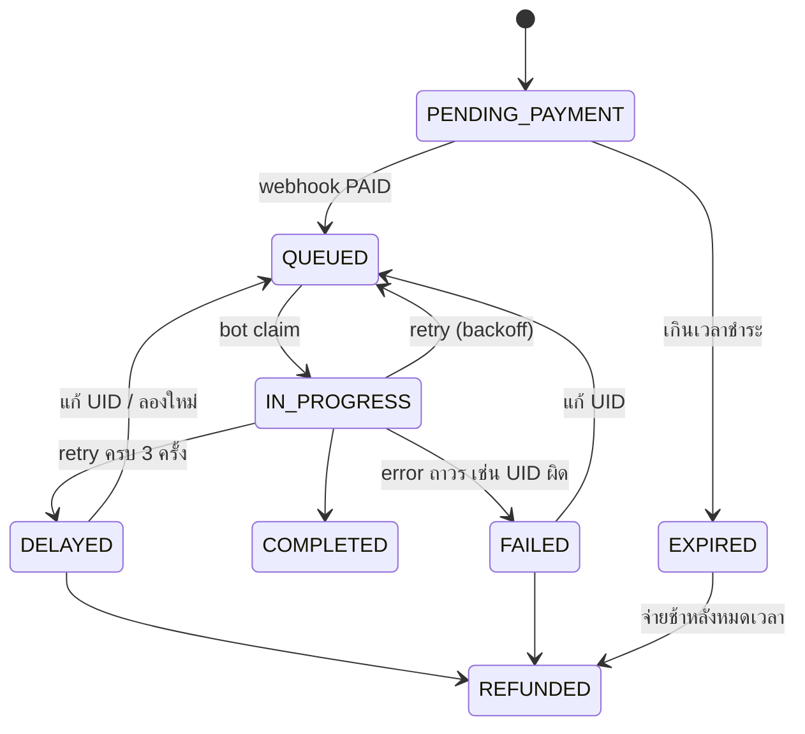

# Order Tracking API

API ติดตามออเดอร์เติมเกมที่ให้ bot จ่ายเงินและเติมให้อัตโนมัติ พร้อมกลไกจัดการเคสปัญหา 5 ข้อ (bot ล่ม, bot แย่งงาน, webhook ซ้ำ/ช้า, เติมไม่สำเร็จ, ออเดอร์ค้าง/หมดอายุ)

- Live demo: `<ใส่ลิงก์ (ถ้ามี)>`
- ทดสอบ API: ไฟล์ `requests.http` (VS Code + ส่วนขยาย REST Client)

## Stack และเหตุผลที่เลือก

| ส่วน | เลือก | เหตุผล |
| --- | --- | --- |
| Runtime | Node.js 22 + Express | ถนัด ตัว framework บางพอให้เห็น logic จริง |
| DB | PostgreSQL 16 | มี `FOR UPDATE SKIP LOCKED`, unique constraint, transaction ที่เคสปัญหาต้องใช้ |
| Data access | `pg` เขียน SQL ตรง ไม่ใช้ ORM | ต้องควบคุม lock และ atomic update เอง ORM จะซ่อนจุดสำคัญ |
| Test | `node:test` (ในตัว Node) | ไม่ต้องลง dev dependency เพิ่ม |
| Deploy | Docker Compose | รันได้คำสั่งเดียว |

Dependency มีแค่ `express` กับ `pg`

## วิธีรัน

```bash
docker compose up --build        # API ที่ http://localhost:3000 (ตาราง DB สร้างเองจาก db/init.sql)
npm install && npm test          # unit test (ใช้ in-memory repo ไม่ต้องมี DB)
npm run pay -- ORD-xxxxxxxxxxxxx-xxx   # จำลอง webhook ธนาคารจ่ายเงินให้ออเดอร์นั้น
```

ลำดับทดลองด้วย `requests.http`: สร้างออเดอร์ → `npm run pay` → `/bot/claim` → `/bot/orders/:no/complete` → ดู `/timeline`

ตัวแปรสภาพแวดล้อม (มีค่าเริ่มต้นสำหรับ dev): `DATABASE_URL`, `API_KEY`, `WEBHOOK_SECRET`, `PAYMENT_TTL_MIN` (15), `LEASE_SEC` (60), `QUEUE_SLA_MIN` (10), `SWEEP_INTERVAL_SEC` (30)

## Endpoints

| Method | Path | หน้าที่ |
| --- | --- | --- |
| POST | `/orders` | สร้างออเดอร์ ต้องมี header `Idempotency-Key` (201 / ส่งซ้ำได้ 200 + `Idempotent-Replay: true`) |
| GET | `/orders/:orderNo` | ค้นด้วยเลข `ORD-ตัวเลข` (400 รูปแบบผิด, 404 ไม่พบ) |
| GET | `/orders?tab=current\|history&page=&pageSize=` | รายการ แบ่งหน้า เรียงใหม่ไปเก่า |
| GET | `/orders/:orderNo/timeline` | ประวัติการเปลี่ยนสถานะพร้อมเวลาและเหตุผล |
| POST | `/orders/:orderNo/report-issue` | ลูกค้าแจ้งปัญหา |
| POST | `/webhooks/bank` | webhook ธนาคาร (ลงนามด้วย HMAC-SHA256 ใน `X-Signature`) |
| POST | `/bot/claim`, `/bot/orders/:no/heartbeat`, `/complete`, `/fail` | API ของ bot (ใช้ `X-Api-Key`) |
| POST | `/admin/orders/:no/fix-uid`, `/refund`, `/admin/sweep` | ทีมซัพพอร์ต (ใช้ `X-Api-Key`) |

Error ทุกรูปแบบเหมือนกัน: `{ "error": { "code": "INVALID_ORDER_NO", "message": "...", "requestId": "..." } }` log เป็น JSON บรรทัดละเหตุการณ์ และใส่ `orderNo` ทุกครั้งที่เกี่ยวกับออเดอร์ จึง `grep` ตามรอยออเดอร์เดียวได้ ทุก response มี header `x-request-id`

## State machine



- กติกาอยู่ที่เดียว (`TRANSITIONS` ใน `src/domain.js`) และทุกการเปลี่ยนสถานะผ่านฟังก์ชันเดียว (`#move` ใน service) ที่ตรวจกติกาก่อนเสมอ จึงเปลี่ยนสถานะข้ามขั้นไม่ได้
- COMPLETED และ REFUNDED เป็นสถานะปลายทาง
- แท็บ **current** = PENDING_PAYMENT, QUEUED, IN_PROGRESS, DELAYED, FAILED ส่วน **history** = COMPLETED, EXPIRED, REFUNDED เหตุผลที่ FAILED อยู่ใน current: ลูกค้ายังแก้ UID แล้วให้ลองใหม่ได้ จึงยังเป็นออเดอร์ที่ต้องทำต่อ

## Schema (db/init.sql)

- `orders`: สถานะ, `attempts`, `version` (optimistic lock), `claimed_by` + `lease_until` (lease ของ bot), `available_at` (ห้าม claim ก่อนเวลานี้ ใช้ทำ backoff), `expires_at` (เส้นตายชำระเงิน), `UNIQUE(order_no)`, `UNIQUE(idempotency_key)`
- `order_events`: timeline ทุกการเปลี่ยนสถานะ (จาก → ไป, เหตุผล, เวลา)
- `processed_events`: event id ของ webhook ที่ประมวลผลแล้ว (primary key)
- `payments`: `order_no` เป็น primary key จึงมีรายการจ่ายได้ไม่เกิน 1 รายการต่อออเดอร์
- `alerts`: primary key `(order_no, type)` ทำให้ alert ชนิดเดียวกันของออเดอร์เดียวไม่เกิดซ้ำ
- `issue_reports`: เรื่องที่ลูกค้าแจ้ง

## เคสปัญหา 5 ข้อ

### 1) Bot จ่ายเงินไม่ทำงาน (ล่ม, cookie หมดอายุ, timeout)
**วิธีแก้:** lease + heartbeat Bot claim ออเดอร์แล้วได้ lease 60 วินาที ต้องเรียก heartbeat เพื่อต่ออายุ ถ้าเงียบจน lease หมด scheduler จะคืนออเดอร์เข้าคิว (QUEUED) พร้อมหน่วง `available_at` แบบ exponential backoff 30s → 60s → 120s ลองได้ 3 ครั้ง (นับตอน claim) ครบแล้วย้ายเป็น **DELAYED** และสร้าง alert `RETRIES_EXHAUSTED`
**เหตุผล:** ไม่ต้องมีตาราง bot registry แยก สถานะ "bot ยังอยู่ไหม" อยู่ในแถวของออเดอร์เอง และเช็กได้ด้วย query เดียว
**ข้อจำกัดที่ยอมรับ:** นี่เป็น at-least-once ถ้า bot จ่ายสำเร็จแล้วล่มก่อนรายงาน การลองใหม่อาจจ่ายซ้ำที่ฝั่ง provider จึงควรให้ bot ตรวจกับ provider ก่อนจ่ายซ้ำ (ใช้ `providerRef` เป็น idempotency key) และออเดอร์ที่ DELAYED ให้คนตรวจก่อนลองใหม่ (ทดสอบ: `case 1` ใน `test/service.test.js`)

### 2) Bot สองตัวแย่งออเดอร์เดียวกัน
**วิธีแก้ 3 ชั้น:**
1. claim เป็น SQL statement เดียว `... FOR UPDATE SKIP LOCKED LIMIT 1` bot ที่มาพร้อมกันจะได้คนละแถว หรือได้ว่าง ไม่มีทางได้แถวเดียวกัน
2. complete/fail ต้องตรง `status = IN_PROGRESS` และ `claimed_by` เป็น bot ที่ถือ lease ถ้า lease หมดและมี bot อื่นมาแย่ง bot เดิมจะได้ 409
3. `payments.order_no` เป็น primary key ถึงโค้ดพลาดก็บันทึกการจ่ายซ้ำไม่ได้
**เหตุผลที่เลือก SKIP LOCKED แทน optimistic lock อย่างเดียว:** optimistic lock ทำให้ bot ที่แพ้ต้อง retry วนซ้ำ ขณะที่ SKIP LOCKED ให้งานคนละชิ้นทันที ส่วนคอลัมน์ `version` ใช้กับ scheduler (ข้อ 5) (ทดสอบ: `case 2`)

### 3) Webhook ธนาคารมาซ้ำ ช้า หรือผิดลำดับ
**วิธีแก้:**
- ตรวจลายเซ็น HMAC-SHA256 จาก **raw body** ด้วย `timingSafeEqual` ถ้าไม่ตรงตอบ 401
- เก็บ `event_id` ใน `processed_events` ใน transaction เดียวกับการเปลี่ยนสถานะ ถ้าเหตุการณ์ล้มเหลวทั้งก้อนจะ rollback ทำให้ไม่มีกรณี "จดว่าประมวลผลแล้วแต่สถานะไม่เปลี่ยน"
- เปลี่ยนสถานะแบบมีเงื่อนไข (`PENDING_PAYMENT → QUEUED` เท่านั้น) จึงรับ event ที่ id ต่างแต่เป็นการจ่ายครั้งเดิมได้โดยไม่เกิดผลซ้ำ (`already_processed`)
- ถ้ามาช้าจนออเดอร์ EXPIRED แล้ว ย้ายเป็น **REFUNDED** (คืนเงิน) พร้อมบันทึกใน timeline
- ตอบ 200 สำหรับกรณีซ้ำหรือประมวลผลแล้ว เพื่อให้ธนาคารหยุดส่งซ้ำ
**ไม่ได้ทำ:** ตรวจยอดเงินใน webhook ว่าตรงกับออเดอร์ (ควรเพิ่มในระบบจริง) (ทดสอบ: `case 3`)

### 4) เติมไม่สำเร็จ (UID ผิด, provider ล่ม)
**วิธีแก้:** Bot รายงานพร้อมค่า `retryable`
- `retryable: false` (เช่น UID ผิด) → **FAILED** ทันที เก็บเหตุผลใน `last_error` และ timeline
- `retryable: true` (เช่น provider timeout) → เข้าวงจร backoff เดียวกับข้อ 1 ครบ 3 ครั้งเป็น DELAYED
- ซัพพอร์ตเรียก `POST /admin/orders/:no/fix-uid` เพื่อแก้ UID แล้วกลับ QUEUED (รีเซ็ต attempts) หรือ `/refund` เพื่อคืนเงิน
**เหตุผล:** ให้ bot เป็นฝ่ายบอกว่า error ชนิดไหน เพราะรู้รายละเอียด provider ดีที่สุด ฝั่ง API จึงไม่ต้องเดาจากข้อความ error (ทดสอบ: `case 4`)

### 5) ออเดอร์ค้างหรือหมดอายุ
**วิธีแก้:** scheduler (`sweep`) รันทุก 30 วินาที และสั่งมือได้ที่ `POST /admin/sweep`
- PENDING_PAYMENT ที่เลย `expires_at` → EXPIRED
- IN_PROGRESS ที่ lease หมด → retry หรือ DELAYED (ข้อ 1)
- QUEUED นานเกิน SLA (10 นาที) → สร้าง alert `QUEUE_SLA_BREACH`
**ทำไมรันซ้ำได้โดยไม่เสียหาย:** ทุกขั้นกรองด้วยสถานะ (ออเดอร์ที่จัดการแล้วไม่ถูกเลือกอีก), การเปลี่ยนสถานะเช็ก `version` (ถ้ามี webhook หรือ heartbeat เข้ามาแทรก การเปลี่ยนของ scheduler จะ conflict และข้ามไป), และ alert มี primary key `(order_no, type)` จึงไม่เกิดซ้ำ รันพร้อมกันหลาย instance ได้ (ทดสอบ: `case 5`)

## Report issue
ลูกค้าแจ้งปัญหาแล้วระบบ **บันทึกและสร้าง alert แต่ไม่เปลี่ยนสถานะ** เพราะถ้าออเดอร์อยู่ IN_PROGRESS bot อาจกำลังจ่ายอยู่ การย้ายสถานะกลางทางจะทำให้ bot รายงาน complete ไม่ได้

## Test
`npm test` รัน 17 กรณีทดสอบ ครอบคลุม state machine, validation, idempotency, pagination, และเคสปัญหาทั้ง 5 ข้อ ใช้ in-memory repo ที่มี contract เดียวกับ `repo.pg.js` และนาฬิกาจำลอง จึงทดสอบเรื่องเวลา (lease, backoff, expiry) ได้โดยไม่ต้องรอจริง

**ขอบเขตของ test:** ครอบคลุม logic ใน service ส่วน SQL (`repo.pg.js`) และ HTTP layer ทดสอบผ่าน `docker compose` + `requests.http` ไม่มี integration test อัตโนมัติ นี่คือสิ่งแรกที่จะเพิ่มต่อ (เช่น Testcontainers)

## ข้อจำกัดและสิ่งที่จะทำต่อ
- Auth ใช้ `X-Api-Key` ร่วมกันสำหรับ bot/admin ระบบจริงควรใช้ key ต่อ bot และ login ลูกค้าก่อนดูหรือแก้ออเดอร์ (เลขออเดอร์ปัจจุบันเดาได้ง่ายเพราะอิงเวลา)
- เวลาที่ใช้ตัดสิน lease/expiry มาจากนาฬิกาของ API server ถ้ารันหลาย instance ควรซิงก์เวลา หรือใช้เวลาของ DB
- Alert ตอนนี้เขียนลง log และตาราง `alerts` ระบบจริงควรส่งต่อไป Slack/LINE
- ไม่มี rate limit และ metrics

## การใช้ AI
ใช้ Claude ช่วยร่างโครงสร้างและโค้ดเริ่มต้น แล้วตรวจทานและรัน test เอง 
